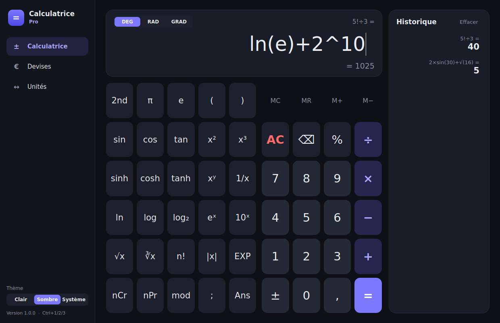
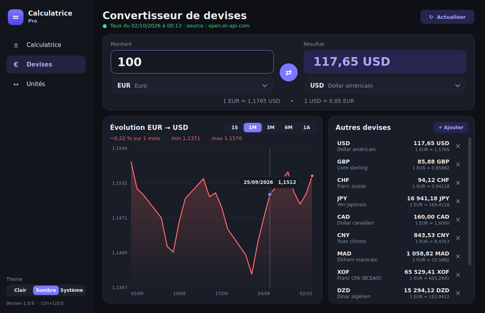
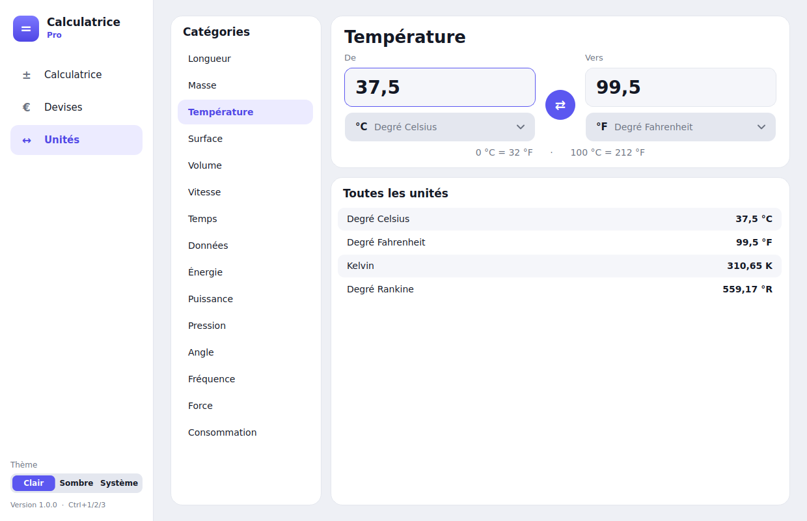

# Calculatrice Pro

Application de bureau pour Windows avec une interface moderne et fluide (Qt) : thème sombre ou clair, animations au survol et au clic, transitions entre les pages, défilement doux, et une mise en page qui s'adapte à toutes les tailles de fenêtre, plein écran compris.

- **Calculatrice scientifique** : trigonométrie (DEG / RAD / GRAD) et fonctions réciproques (touche `2nd`), fonctions hyperboliques, `ln`, `log`, `log₂`, puissances et racines, factorielle, `nCr` / `nPr`, `mod`, valeur absolue, notation `EXP`, pourcentages (`200+10%` donne 220), mémoire (`MC`, `MR`, `M+`, `M−`), `Ans`, aperçu du résultat pendant la saisie et historique cliquable conservé d'une session à l'autre.
- **Taux de change** : plus de 160 devises avec les taux du jour, recherche par code ou par nom (« dollar », « MAD »…), liste de devises favorites et graphique d'évolution sur 1 semaine, 1, 3 ou 6 mois, ou 1 an.
- **Conversion d'unités** : 15 catégories (longueur, masse, température, surface, volume, vitesse, temps, données, énergie, puissance, pression, angle, fréquence, force, consommation de carburant), conversion dans les deux sens et tableau de toutes les unités de la catégorie.

| Calculatrice | Devises | Unités |
|---|---|---|
|  |  |  |

*Captures faites avec des données d'exemple.*

## Télécharger le .exe

L'exécutable est compilé automatiquement par GitHub Actions à chaque push :

1. Ouvrez l'onglet **Actions** du dépôt, puis la dernière exécution réussie de « Construire l'exécutable Windows ».
2. En bas de la page, section **Artifacts**, téléchargez **CalculatricePro-Windows** (un fichier `.zip`).
3. Décompressez-le : vous obtenez `CalculatricePro.exe`, qu'il suffit de lancer. Aucune installation n'est nécessaire.

Pour publier une version dans l'onglet **Releases**, poussez un tag commençant par `v` (par exemple `git tag v1.0.0 && git push origin v1.0.0`). Le `.exe` y est alors joint automatiquement.

> L'exécutable n'est pas signé numériquement. Au premier lancement, Windows SmartScreen peut afficher « Windows a protégé votre ordinateur » : cliquez sur **Informations complémentaires** puis **Exécuter quand même**.

## Raccourcis clavier

| Touche | Action |
|---|---|
| Chiffres, `+ - * / ^ ( ) ! %` | saisie (les touches `*`, `/`, `-` et `.` donnent `×`, `÷`, `−` et `,`) |
| `Entrée` ou `=` | calculer |
| `Échap` | tout effacer |
| `Retour arrière` | effacer le dernier élément (une fonction comme `sin(` est effacée d'un coup) |
| `Ctrl+1` / `Ctrl+2` / `Ctrl+3` | Calculatrice / Devises / Unités |

On peut aussi taper des fonctions au clavier (`sin(30)`, `sqrt(2)`, `log(8;2)`, `5 mod 3`…). Le séparateur décimal est la virgule (le point est accepté) et les arguments se séparent par `;`. Les champs des convertisseurs acceptent aussi des expressions (`2×3,5`, `1/3`…).

## Taux de change

- Taux du jour : [open.er-api.com](https://open.er-api.com), avec [Frankfurter](https://frankfurter.dev) (BCE) et [currency-api](https://github.com/fawazahmed0/exchange-api) en secours. Ces services sont gratuits et ne demandent pas de clé.
- Historique : Frankfurter pour les devises suivies par la BCE, currency-api pour les autres (MAD, XOF, DZD…).
- Les derniers taux téléchargés sont enregistrés et restent utilisables hors ligne. Au tout premier lancement sans Internet, l'application affiche des taux approximatifs intégrés, signalés en rouge.

Les réglages, l'historique et le cache des taux sont stockés dans `%APPDATA%\CalculatricePro`.

## Lancer depuis les sources

Il faut Python 3.11 ou plus récent.

```bash
pip install -r requirements.txt
python main.py
```

## Compiler le .exe soi-même (Windows)

Double-cliquez sur `build.bat`, ou bien :

```bash
pip install -r requirements-dev.txt
python -m pytest
pyinstaller --noconfirm --clean CalculatricePro.spec
```

Le fichier est créé dans `dist\CalculatricePro.exe`.

## Organisation du code

```
main.py                     point d'entrée (et auto-test --self-test)
calculatrice/
  app.py                    fenêtre principale, barre latérale, thème, tâches en arrière-plan
  storage.py                réglages et dossier de données
  core/evaluator.py         analyse et calcul des expressions (sans eval)
  core/units.py             unités et conversions
  core/currency.py          taux de change : API, cache, historique
  core/search.py            recherche sans accents dans les listes
  ui/widgets.py             widgets animés (boutons, sélecteurs, graphique, transitions)
  ui/                       pages Qt (calculatrice, devises, unités) et thème
tests/                      tests unitaires et tests de l'interface (pytest)
tools/make_icon.py          génération de l'icône
```
